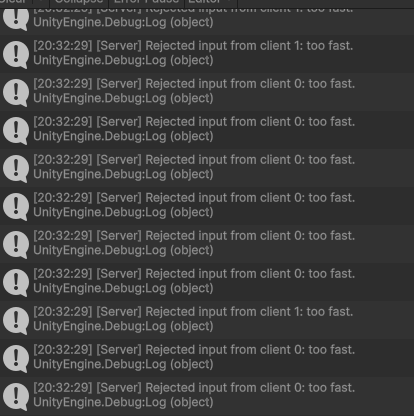

# Week 4 — The server decides

Mert Çiçek · DGD0005 Multiplayer Programming · Homework 2

---

## Step 2

**RTT (HUD, client window):** 20 ms. Pressing W, my paddle moves in every window, mine too, about one round trip late: the input goes to the server, the server moves the paddle, the position comes back.

---

## Step 3

**The server receives `axis = 50`. Which line makes the paddle move at normal speed, and on which machine does that line run?**
`axis = Mathf.Clamp(axis, -1f, 1f);` in `ServerSetAxis`. It runs on the **server**, because `ServerSetAxis` is a `[ServerRpc]`: the client only calls it, the body runs on the server. So 50 becomes 1 before it is written to `_serverAxis`.

---

## Step 4

**Why 30 ms?** At tick rate 30 one tick is about 33 ms, and a keyboard sends exactly one input per tick. 30 ms is just under one tick, so every honest input passes, but a second input inside the same tick is not a keyboard, it is a program, and the server refuses it.

**What happens with 5 ms?** The limit is far below one tick, so it no longer means "one input per tick": a program could send up to 200 inputs a second and the server would accept them. Almost no protection.

**What happens with 500 ms?** The limit is much bigger than one tick, so the server accepts only 2 inputs a second and rejects about 14 of every 15 honest ones. My own paddle stutters and reacts up to half a second late (it keeps moving after I let go of W), and the rejected counter climbs during normal play.

The timestamp `_lastInputTime` is an **instance** field, not `static`: one per paddle = one per client, so my inputs never block the other player's paddle.

**Rejections in normal play.** With Multiplayer Play Mode (three Unity windows on one PC) a window that is in the background or slow can drop below 30 fps; FishNet then runs two or three ticks in one frame, so that client sends two or three inputs at once and they reach the server in the same tick, where the second one is "too fast". With every window visible and Interaction Mode set to *No Throttling* this fell from about 10 a second to a few every ten seconds. That is also why my Step 5 screenshot has a couple of `client 1` lines between the `client 0` lines from the C key.

---

## Step 5 — The cheating client

Debug keys in `Update`, after the owner guard: **C** calls `ServerSetAxis(1f)` 20 times in one frame, **X** calls `ServerSetAxis(50f)` once, **T** sets `transform.position` to the ball on the client, no RPC.

| Key | Server console | Paddle |
|---|---|---|
| C once | 19 × `[Server] Rejected input … too fast.`, counter +19 | moves at normal speed |
| X once | nothing | moves at normal speed, never faster |
| T once | nothing | jumps, then snaps back within a tick |

**Server Console after one C:**

1. **C sends 20 inputs and the server accepts one. Why is the paddle not 20 times faster?** The server keeps only one `_serverAxis` and moves the paddle once per tick by `_serverAxis * speed * TickDelta`, so the number of messages never changes how far it moves.
2. **T moved the paddle on your screen. Why did the ball on the server not notice?** The teleport only changed my local copy and sent nothing; the ball collides with the server's copy of my paddle, which never moved, and the server's `NetworkTransform` overwrote my position on the next tick.
3. **Which of the three cheats would also fail without the rate limit, and why?** X and T: X is cut to 1 by `Mathf.Clamp`, and T never reaches the server at all, so server authority alone defeats both; only C (the flood) needs the rate limit.

---

## Vocabulary (for the demo)

| Word | Meaning, in my words |
|---|---|
| server-authoritative | The server owns the truth: it computes the state, clients only send input and show the result. |
| input vs. state | The client sends what the player *wants* (axis); the server decides what *happens* (position). |
| validation | The server checking a request before believing it: well-formed → too fast → allowed by the game rule → write state → announce. |
| rate limit | Refusing a second request from the same client inside a time window (30 ms here). |
| tick / TickDelta | One fixed server step; `TickDelta` is its length in seconds (1/30). |

**The pointed-at line:** `axis = Mathf.Clamp(axis, -1f, 1f);` in `ServerSetAxis` — it runs on the server, so the client cannot decide how fast its paddle moves.
