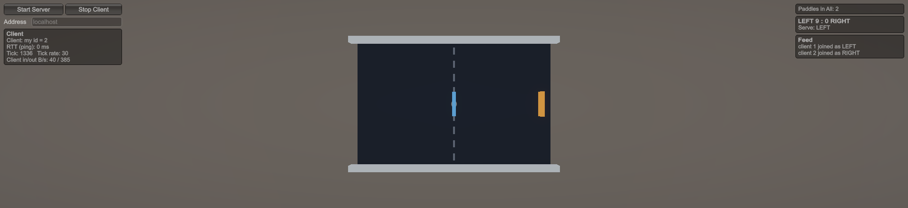

# Week 6 — The Host Cheats, and the Join Code

Mert Çiçek · DGD0005 Multiplayer Programming · Homework 3

In every step the main editor clicks **Start Host**; the Multiplayer Play Mode instance is the guest.

---

## Step 1 — The guest cheats

`PaddleController.Update`, next to C, X, T: **G** writes `GameState.Instance.LeftScore.Value = 9;` directly, no RPC.

| Key, on the guest | Host Console | What both windows show |
|---|---|---|
| C | 19 lines `Rejected input … too fast` | the paddle moves at normal speed |
| X | nothing | normal speed, never faster |
| T | nothing | jumps in the guest window only, snaps back |
| G | nothing | the host's score does not change |

**G wrote a SyncVar on the guest. Why did the host never see it?**
A SyncVar only travels server → clients; the guest is not the server, so its write stayed on the guest (FishNet does not even accept it there) and no message ever went to the host.

## Step 2 — Serve rate limit

`PaddleController.RequestServe` (the `[ServerRpc]`): after the null check, before the `ServingSide` check, the server reads `TimeManager.TicksToTime(TimeManager.Tick)`. A second request inside `MinServeGap = 1.0` s gets `TargetRefused(Owner, "TOO FAST")` and returns. `_lastServeTime` is an instance field: one timestamp per paddle, so one limit per player. The refusal is a `[TargetRpc]`, so only the player who asked sees `TOO FAST`.

## Step 3 — The host cheats

Same keys, pressed in the **host** window, then Speed 8 → 40 on the host's paddle in the Inspector.

| On the host | Result | Why |
|---|---|---|
| C | 19 rejected. Normal speed | it is a request. The check runs for the host too |
| X | normal speed | it is a request. The clamp runs |
| T | the paddle jumps to the ball and stays. In both windows | a direct write. On the host, that is the server's position |
| G | LEFT has 9. In both windows | a direct write. On the host, that is the server's score |
| Speed 40 | the host's paddle is five times faster. In both windows | the host's numbers are the rules |

Guest window after the host pressed G:

1. **C and X failed on the host, T and G worked. The difference?** C and X are requests (ServerRpcs) that go through the server's checks, which also run for the host; T and G write state directly, and on the host the local copy *is* the server's copy, so nothing checks them.
2. **Which of the host's cheats could a guest see?** T, G and Speed 40 — the paddle on the ball, LEFT at 9 and the five-times-faster paddle all show in the guest window, because the host's state is what the guest mirrors.
3. **Ranked game with strangers: host or dedicated server?** A dedicated server, because on a host one of the players owns the rules and can cheat without any check stopping them.

## Step 5 — RelayLink.cs

## Step 6 — Two buttons and a code

## Step 7 — Your partner, from another network
